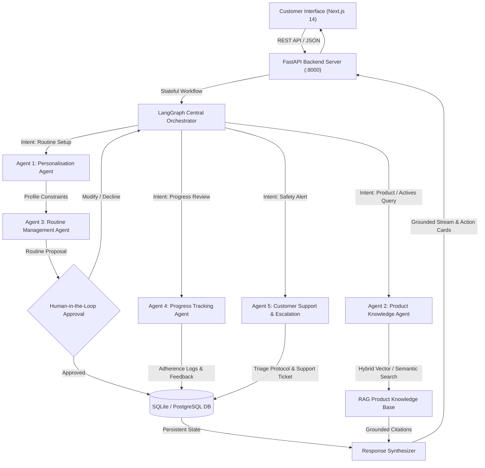

# Bodywise AI Companion — Agentic Personal-Care Assistant

**Be Bodywise Brand | Mosaic Wellness Fellowship Builder Challenge**

---

## 🌐 Live Deployment

| Component | URL |
|---|---|
| **Live Web Application** | https://bodywise-ai-companion.vercel.app |
| **Backend API** | https://bodywise-backend-xoyc.onrender.com |
| **Swagger Documentation** | https://bodywise-backend-xoyc.onrender.com/docs |
| **System Health** | https://bodywise-backend-xoyc.onrender.com/api/health |
| **GitHub Repository** | https://github.com/kavyagada20/bodywise-ai-companion |

---

## 🌟 Project Overview

**Bodywise AI Companion** is an Agentic AI-powered personal-care assistant designed to guide customers through their personal-care journey. Built with a premium **Sage & Forest Green** design system, the application pairs high-trust clinical wellness branding with multi-agent intelligence.

While conventional chatbots operate as passive, single-turn Q&A interfaces, Bodywise AI Companion coordinates **five specialized AI agents** through **LangGraph**. The system maintains user context, retrieves verified Be Bodywise product formulations via **Retrieval-Augmented Generation (RAG)**, manages dynamic morning and evening routine schedules with **human-in-the-loop approval**, tracks weekly adherence analytics, and enforces safety triage for adverse reactions or chemical sensitivities.

---

## 🎨 Premium Sage & Forest Green Design System

The application features a bespoke, production-ready wellness UI design:

| Token | Role | Hex Code |
|---|---|---|
| **Primary Forest Green** | Deep forest buttons, primary headers, active nav | `#173F35` |
| **Secondary Green** | Interactive elements, chart curves | `#477C68` |
| **Sage Green** | Accents, badges, muted borders | `#A8BDA9` |
| **Light Sage** | Card accents, soft highlights | `#EDF3ED` |
| **Page Background** | Warm off-white page canvas | `#F5F5EF` |
| **Card Background** | Clean white cards | `#FFFFFF` |
| **Main Text** | Dark charcoal body & headings | `#252D29` |
| **Secondary Text** | Muted grey-green captions | `#727B74` |
| **Borders** | Soft subtle grey-green | `#E3E8E1` |

---

## 🏗️ Architecture & Agent Orchestration

The application utilizes a stateful **LangGraph** orchestration graph to classify user intent, route execution through domain agents, query verified knowledge bases, and require human approval for routine changes before database persistence.



---

## 🤖 The Five Specialised Agents

| Agent | Core Responsibilities | Safety & Operational Constraints |
| :--- | :--- | :--- |
| **1. Personalisation Agent** | Ingests the customer's onboarding profile (age, primary concern, secondary concerns, habits, sensitivity preferences) and structures tailored care regimens. | Explains the clinical rationale behind each recommendation based on verified target concerns. |
| **2. Product Knowledge Agent** | Executes hybrid TF-IDF and semantic vector search across the verified Be Bodywise product catalogue. Answers ingredient, active concentration, and usage questions. | Grounds answers strictly in approved brand formulations; never fabricates concentrations, prices, or cure claims. |
| **3. Routine Management Agent** | Generates daily (morning/night) and weekly routine schedules. Connects to backend tools (`create_routine`, `get_routine`, `mark_task_complete`, `schedule_reminder`). | **Consequential Action Safeguard:** Requires explicit user approval in the chat UI before creating or modifying active database routines. |
| **4. Progress Tracking Agent** | Evaluates 7-day routine adherence, computes consistency trends (e.g. morning vs. evening compliance), and synthesizes weekly check-in summaries. | Analyzes customer-reported feedback without diagnosing health conditions or guaranteeing outcomes. |
| **5. Customer Support & Escalation Agent** | Detects mentions of stinging, chemical burning, swelling, or severe rashes. Halts product use, disclaims medical advice, and issues official support escalation tickets (`#BW-ESC-...`). | Directs users to healthcare professionals and connects them to human personal care representatives. |

---

## 🚀 Key Features

- **Personalisation Onboarding:** 9-question interactive intake capturing concern categories (Hair fall, Dandruff, Hair growth, Acne, Pigmentation, Dry skin, Body acne, General maintenance), existing habits, and reminder preferences.
- **Overview Dashboard:** Live morning/evening routine checklist, daily completion progress bar, 7-day consistency streak counter, contextual AI prompt card, and concern-matched product recommendations.
- **AI Companion Conversational UI:** Real-time multi-agent chat showing step-by-step agent activity traces, grounded product citations with source URLs, interactive routine action proposal cards, and safety escalation alerts.
- **Product Discovery Catalogue:** Searchable Be Bodywise catalogue filtered by category (Hair, Face, Body, Nutrition) and target concern. Detailed modal showcasing verified ingredients, active compounds, step-by-step usage instructions, warnings, and FAQs.
- **My Routine Management:** Daily morning/evening split, weekly calendar ribbon, real-time task completion toggle, reminder scheduling modal, and missed-routine recovery guidance.
- **Progress Tracker & Check-in:** Interactive Recharts area and bar charts tracking weekly compliance %, completed vs. missed activities, weekly check-in submission form, and AI-generated summary history.
- **Support Escalation Log:** Persistent ticket tracking for reported adverse sensitivities with human specialist handoff.
- **Demonstration Mode:** Deterministic, verified execution mode ensuring the entire application and all multi-agent workflows function out-of-the-box without requiring external paid API keys.
- **Persistent Relational Database:** Full SQLAlchemy ORM schema supporting SQLite locally and PostgreSQL in production environments.

---

## 🛠️ Technology Stack

- **Frontend:** Next.js 14 (App Router), React 18, TypeScript, Tailwind CSS, Lucide React icons, Recharts (Hosted on **Vercel**).
- **Backend:** Python 3.11+, FastAPI, Pydantic v2, SQLAlchemy 2.0, SQLite (local) / PostgreSQL (production) (Hosted on **Render**).
- **Agentic AI & Orchestration:** LangGraph (StateGraph), Google Gemini API (`google.generativeai`), Hybrid TF-IDF & Cosine Similarity Vector Retrieval.
- **Testing:** Pytest, FastAPI TestClient.
- **Containerisation:** Docker, Docker Compose.

---

## 📁 Project Structure

```
Bodywise AI Companion/
├── backend/
│   ├── app/
│   │   ├── agents/
│   │   │   └── orchestrator.py        # LangGraph Multi-Agent Orchestrator & StateGraph
│   │   ├── rag/
│   │   │   └── knowledge_base.py      # TF-IDF & Vector RAG Ingestion & Search Engine
│   │   ├── routers/
│   │   │   ├── auth.py                # Authentication, Registration & Demo Login
│   │   │   ├── companion.py           # AI Companion Chat, Tool Approval & Action Cards
│   │   │   ├── escalations.py         # Customer Support Escalation Ticket Endpoints
│   │   │   ├── products.py            # Product Catalogue, Detail & AI Explanation
│   │   │   ├── profile.py             # Personalisation Onboarding & Profile Management
│   │   │   ├── progress.py            # Adherence Analytics, Check-ins & AI Summaries
│   │   │   ├── reminders.py           # In-app Reminder Scheduling & Toggles
│   │   │   ├── routines.py            # Daily Schedules, Tasks & Completion Toggles
│   │   │   └── settings_router.py     # System Status, Demo Mode & API Key Config
│   │   ├── auth_utils.py              # JWT Token Handling & Password Hashing
│   │   ├── config.py                  # Pydantic BaseSettings Configuration
│   │   ├── database.py                # SQLAlchemy Engine, SessionLocal & Base
│   │   ├── main.py                    # FastAPI Lifespan, CORS & Router Mounting
│   │   ├── models.py                  # Relational Database Models (11 Tables)
│   │   ├── schemas.py                 # Pydantic Validation & Serialization Schemas
│   │   └── seed_data.py               # Verified Be Bodywise Catalogue & Demo Data
│   ├── tests/
│   │   └── test_api.py                # Automated Pytest Suite (6 Acceptance Criteria)
│   ├── .dockerignore
│   ├── .env.example
│   ├── Dockerfile
│   └── requirements.txt
├── frontend/
│   ├── public/
│   │   └── icon.svg                   # Brand Favicon SVG Asset
│   ├── src/
│   │   ├── app/
│   │   │   ├── globals.css            # Sage & Forest Green Theme & Utility Tokens
│   │   │   ├── layout.tsx             # Root Layout & Metadata
│   │   │   └── page.tsx               # Main Dashboard & View Orchestrator
│   │   ├── components/
│   │   │   ├── CompanionView.tsx      # Agentic Chat, Traces & Human-in-the-Loop UI
│   │   │   ├── DashboardView.tsx      # Overview Dashboard, Quick Actions & Regimen
│   │   │   ├── Navigation.tsx         # Responsive Header, Brand Mark & Profile Control
│   │   │   ├── ProductsView.tsx       # Verified Product Discovery & Detail Modal
│   │   │   ├── ProfileView.tsx        # 9-Step Personalisation Onboarding Wizard
│   │   │   ├── ProgressView.tsx       # Recharts Analytics & Weekly Check-in Form
│   │   │   ├── RoutineView.tsx        # Morning & Evening Schedules & Reminders
│   │   │   └── SettingsView.tsx       # Configuration, Demo Toggle & Ticket Logs
│   │   └── lib/
│   │       └── api.ts                 # Dynamic Cloud Resolution & Typed REST Client
│   ├── .dockerignore
│   ├── .env.example
│   ├── Dockerfile
│   ├── next.config.js
│   ├── package.json
│   ├── postcss.config.js
│   ├── tailwind.config.js
│   └── tsconfig.json
├── .dockerignore
├── .env.example
├── .gitignore
├── docker-compose.yml
├── README.md
├── start_all.ps1
├── start_backend.bat
└── start_frontend.bat
```

---

## ⚡ Quick Start (Windows PowerShell)

### Prerequisites
- Python 3.10+ (tested on Python 3.13)
- Node.js 18+ and npm

### Method 1: Automated Launch (Recommended)
Run the automated launcher from the project root:
```powershell
.\start_all.ps1
```
This script launches the FastAPI backend on port `8000` and the Next.js frontend on port `3000` in separate terminal windows.

- **Frontend Application:** [http://localhost:3000](http://localhost:3000)
- **Backend Interactive API Docs (Swagger):** [http://localhost:8000/docs](http://localhost:8000/docs)

---

### Method 2: Manual Terminal Setup

#### Step 1: Start the Backend
```powershell
cd backend
python -m venv venv
.\venv\Scripts\activate
pip install -r requirements.txt
python -m uvicorn app.main:app --host 0.0.0.0 --port 8000 --reload
```

#### Step 2: Start the Frontend
In a separate terminal window:
```powershell
cd frontend
npm install
npm run dev
```

---

### Method 3: Docker Compose
```bash
docker-compose up --build
```

---

## ⚙️ Environment Setup

1. Copy the example environment files:
   - Root: `copy .env.example .env`
   - Backend: `copy backend\.env.example backend\.env`
   - Frontend: `copy frontend\.env.example frontend\.env`

2. Configuration variables:
   - `DEMO_MODE=true` (runs out-of-the-box without external API dependencies)
   - `GEMINI_API_KEY=""` (optional: add your Google AI Studio key to enable live Gemini 1.5 Flash generation)
   - `DATABASE_URL=sqlite:///./bodywise.db` (automatically created and seeded on first run)
   - `NEXT_PUBLIC_API_URL=http://localhost:8000`

---

## 🔑 Demo Access & Reviewer Credentials

The application includes an pre-seeded reviewer profile so evaluators can test immediately without registration:

- **Email:** `kavya@bodywise.demo`
- **Password:** `demo123`
- **One-Click Access:** The web application automatically authenticates as this demonstration user upon launch or via the **Demo Mode** indicator.

---

## 🧪 Automated Testing & Acceptance Verification

Run the test suite verifying all endpoints and multi-agent workflows:

```powershell
.\backend\venv\Scripts\pytest .\backend\tests\test_api.py -v
```

### Verified Test Results:
```
============================= test session starts =============================
platform win32 -- Python 3.13.9, pytest-9.2.0, pluggy-1.7.0
rootdir: C:\Users\kavyagada\Downloads\Bodywise AI Companion — Agentic Personal-Care Assistant
collected 9 items

backend/tests/test_api.py::test_health_check PASSED                      [ 11%]
backend/tests/test_api.py::test_demo_login PASSED                        [ 22%]
backend/tests/test_api.py::test_product_catalogue_and_search PASSED      [ 33%]
backend/tests/test_api.py::test_demo_1_onboarding_and_routine_generation PASSED [ 44%]
backend/tests/test_api.py::test_demo_2_ai_routine_proposal_and_approval PASSED [ 55%]
backend/tests/test_api.py::test_demo_3_task_completion_and_adherence PASSED [ 66%]
backend/tests/test_api.py::test_demo_4_product_question_grounded_rag PASSED [ 77%]
backend/tests/test_api.py::test_demo_5_weekly_check_in_and_summary PASSED [ 88%]
backend/tests/test_api.py::test_demo_6_safety_escalation PASSED          [100%]

======================= 9 passed in 4.64s =======================
```

---

## 🔒 Security & Responsible AI Safeguards

1. **Medical Non-Diagnosis Guarantee:** The assistant strictly advises users that it cannot provide medical diagnosis, dermatological prescriptions, or guaranteed cure outcomes.
2. **Human-in-the-Loop Safeguard:** Consequential actions—specifically creating or replacing active daily routines—cannot be executed by an AI agent unilaterally without explicit customer confirmation.
3. **Grounded Source Bounding:** The Product Knowledge Agent is grounded against verified public Be Bodywise formulations to eliminate ingredient hallucination.
4. **Adverse Reaction Escalation:** Customers reporting severe irritation receive immediate triage instructions and an auto-generated support escalation ticket.
5. **Zero Secret Exposure:** Environment variables are strictly separated between backend and client-safe public variables; all real `.env` files and databases are git-ignored.

---

## 👤 Project Information

- **Project:** Bodywise AI Companion — Agentic Personal-Care Assistant
- **Brand:** Be Bodywise (Mosaic Wellness)
- **Challenge:** Mosaic Wellness Fellowship Builder Challenge
- **Developer:** Kavya Gada
